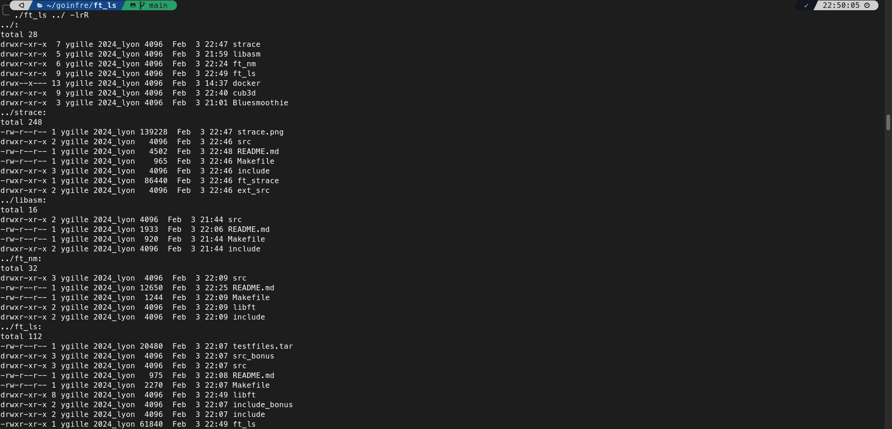

# FT_LS

Just like ls



## Usage

```bash
ls [OPTION]... [FILE]...
```

## Options

With no option, the program lists the current directory. Given paths, it sorts them together with `strcoll`, using `LC_COLLATE`. It prints non-directories first: regular files, symlinks, fifos, sockets, and devices. It lists directories afterwards, in that same order. Inside a directory, all of these types stay in one sorted list.

`-l` prints one line per entry: type and permissions (`st_mode`), link count (`st_nlink`), owner (`st_uid`, name from `getpwuid`), group (`st_gid`, name from `getgrgid`), size (`st_size`), modification time (`st_mtime`), and name. A block or character device shows `major` and `minor` of `st_rdev` instead of the size. When the owner or group name cannot be found, the numeric id is printed. The date shows the time when the file is less than six months old, and the year otherwise. A directory listing starts with `total`, derived from `st_blocks`.

With `-l`, every path is read with `lstat`. A symlink is shown as a symlink, followed by `->` and the target returned by `readlink`. A symlink to a directory stays on one line, and its contents are not listed. Without `-l`, a symlink given as an argument is followed with `stat` first. When it points to a directory, that directory is listed. When it points elsewhere, or the target is missing, `lstat` describes the link itself.

`-a` keeps names that start with `.`, including `.` and `..`. Without it, those names are omitted.

`-R` opens each subdirectory after printing it. `.` and `..` are not descended into. A symlink found inside a directory is not followed, even when it points to a directory. A symlink to a directory given as an argument is opened only when `-l` is absent. With `-R`, or whenever the command has more than one operand, each directory is preceded by its name and `:`. A single directory, without `-R`, has no such header.

`-t` sorts by modification time, newest first. The key is `st_mtim`, seconds then nanoseconds. When the times are equal, the tie is broken with `strcoll` on the name. The split between the file group and the directory group stays the same.

`-r` reverses that sort. Without `-t`, names follow the reverse of `strcoll`. With `-t`, the oldest comes first, and the name tie-break is reversed as well.

The five options combine. `-l` sets the format and whether argument symlinks are followed. `-a` sets which names are kept. `-t` and `-r` set the order. `-R` sets which directories are opened.
